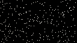
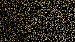
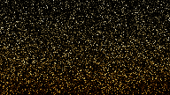
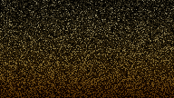

# Moving eclipse noise

Moving time or the camera resets accumulation, so each displayed frame usually
has one camera-path sample. Two atmospheric estimators made that sample noisy:

- Daylight planetshine roulette could keep only 1/64 of reflected contributions
  and multiply the survivors by 64. Its daylight importance estimate deliberately
  ignores occultation, so this also happened against a dark eclipsed sky.
- Each atmospheric integration point sampled one random position on a finite
  star. A thin visible crescent produced occasional bright shadow samples.

The renderer now keeps all planetshine on a fresh frame. Its minimum survival
probability gradually decreases as `1/sqrt(accumulated_samples + 1)`, reaching the
existing 1/64 floor at sample 4096. Contributions still divide by their actual
survival probability; expected energy is preserved.

On the first sample, an atmospheric point near a spherical eclipse edge takes
four jittered, equal-solid-angle strata on the star's disc and averages them.
The angular test uses stable chord distances, including for tiny stars. It runs
at each scattering point because distant air can be partly illuminated while the
observer is in totality. Visibility still uses the existing sphere, ring and
terrain shadow rays. The overlap test only selects a sample count; it never
substitutes approximate visibility. Later accumulated samples use one shadow
sample per point as before.

## GPU measurements

AMD Radeon RX 7600 XT, Vulkan, RADV Mesa 26.2.2-arch1.1. Error is mean squared
linear Rec.709 luminance error against a 1024-sample reference, summed over
independently reset moving frames. The planetshine reference disables roulette.
The sun reference retains the original one-disc-sample estimator after its first
sample. These finite references share the first sample with the candidates;
they are regression measurements, not exact solutions of atmospheric transport.

| Isolated moving view | Before MSE | After MSE | Reduction |
|---|---:|---:|---:|
| Eclipsed planetshine, 128×72, four frames | 0.001619 | 0.0001906 | 88% |
| Sun penumbra in air, 192×108, three frames | 0.0001762 | 0.00003742 | 79% |

Each frame still has **one camera-path sample**. Extra work is in light sampling.
Both comparisons preserve the same physical scene, camera, exposure and materials.

| View | Before | After |
|---|---|---|
| Eclipsed planetshine, exposure 20 |  |  |
| Sun penumbra in air, exposure 10 |  |  |

At 4096 samples, production and roulette-free reference mean luminance differ by
0.022% in the planetshine fixture and less than 0.001% in the sun fixture. Tests
also compare 1- and 64-sample batches exactly, including a partial final batch,
sample-limit completion and a subsequent moving frame. Calyx's off-disc night
glow, all six textured reflectors and the sharp umbra edge retain their existing
GPU regression checks.

This addresses atmospheric speckles. The authored Umbra totality view's overall
error is essentially unchanged: tiny bright body edges dominate that image's
error. Ring sampling, indirect ground paths and subpixel celestial silhouettes
can still be noisy. The renderer continues to reset on motion, so there is no
history trail through a moving eclipse.

## Cost

GPU timing includes tracing, sky-cache rebuilds on reset, exposure and offscreen
display. It excludes scene construction, UI, compositor and VSync; these numbers
are not application FPS. Six benchmark fixtures use 640×360, four bounces, 70%
vegetation, two warm-up frames and three repeats of eight measured frames.
Baseline is release commit `1a7625e`. Separate runs were used; clocks and
background load were not controlled.

| Advancing view | Before GPU median, ms | After GPU median, ms |
|---|---:|---:|
| Eclipse totality | 0.639 | 0.961 |
| Sharp umbra edge | 1.191 | 1.431 |
| Moonlit air | 1.733 | 2.005 |
| Earth daylight | 16.662 | 17.941 |
| Level 1 | 6.530 | 7.571 |
| Level 3 (daylight start) | 7.492 | 7.795 |

The added first-frame light samples trade GPU time for lower noise. This includes
roughly 0.3 ms extra in the synthetic eclipse and 1.0 ms in level 1 on this GPU.
The moonlit-air images are byte-identical to baseline despite a timing increase:
that fixture already evaluated all reflected light, so only shader overhead
changed there. Paused medians vary from 0.548 to 18.730 ms across these cases;
Earth daylight is about 6% slower even when paused. The extra shadow samples
finish after the first sample, but the compiled light loop still has a cost.

## Reproduce

```sh
STARGAZE_TEST_IMAGE_DIR=target/eclipse-previews cargo test --release gpu_moving_eclipse -- --ignored --nocapture --test-threads=1
cargo test --release gpu_eclipse_energy_and_sample_batching -- --ignored --nocapture
cargo test --release gpu_authored_umbra_eclipse_is_preserved -- --ignored --nocapture
cargo test --release planetshine:: -- --ignored --nocapture --test-threads=1
cargo test --release gpu_umbra_edge_contrast -- --ignored --nocapture
python scripts/benchmark.py run /tmp/eclipse-bench --width 640 --height 360 --scale 100 --warmup 2 --frames 8 --repeats 3 --image-samples 64 --cases eclipse-totality eclipse-umbra-edge moonlit-air earth-daylight level-1 level-3
```

GPU tests are opt-in; hosted CI validates shaders but cannot run these captures.
The older `gpu_night_ground_has_no_catalogue_fireflies` test fails its `1e-12`
absolute darkness assertion on this GPU on both unchanged release and candidate:
maximum red radiance is exactly `1.1019368e-10` in both, with zero pixels above
its visible-speckle threshold. Its assertion is left intact.
